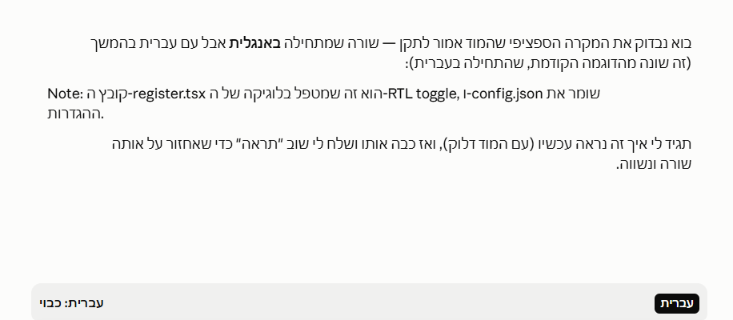

# RTL Toggle

A Claude Code mod that corrects the reading order of chat messages which mix
English and Hebrew (or other right-to-left) text.

## Problem

Standard Unicode bidi handling renders a line correctly when the line's first
strong-directional character already matches its intended direction. It does
not always do so for a Latin-leading line with Hebrew embedded further in:
the Hebrew segment can end up visually shifted or reordered relative to the
surrounding English text. For example, a line such as:

```
Mixed עברית text
```

may render with the Hebrew word out of position relative to the English
words around it, even though the underlying text is correct. This mod
detects that specific case and corrects the rendering.

## How it works

The mod adds a button above the prompt. Its label shows the current state
(`עברית: פעיל` on, `עברית: כבוי` off); pressing it toggles a session-scoped setting. The
button is drawn alongside whatever else the band shows (surveys, other mods).

While the toggle is on, every line of every `UserMessage` and
`AssistantMessage` is inspected individually. A line is wrapped in a Unicode
bidi **isolate** (RLI U+2067 ... PDI U+2069) only when all of these hold:

- it starts (after any markdown prefix) with a Latin letter;
- it is predominantly RTL: RTL letters (Hebrew, Arabic and their supplement and
  presentation-form blocks) make up more than `RTL_DOMINANCE_THRESHOLD` (0.5) of
  its Hebrew/Arabic + Latin letters. An English sentence with one Hebrew word is
  therefore left alone.

Everything else is untouched:

- Hebrew/Arabic-leading lines (the bidi algorithm already handles them) and
  lines with no RTL text.
- Lines inside fenced code blocks (``` or ~~~) and the fence lines themselves.
- Indented (4 spaces / tab) code lines and table rows (`|`); table rows are
  skipped entirely rather than wrapped per cell.
- Lines already wrapped (RLI, or the legacy RLE from older versions).

The markdown prefix (indentation, `>` quotes, `-`/`*`/`+`/`1.` list markers,
task checkboxes, `#` headings) stays at column 0; the RLI is inserted after it.
For CRLF text the PDI goes before the trailing `
`.

While the toggle is off, no message text is modified.

## Usage

1. Open Claude Code with this mod enabled.
2. Click the button above the prompt to turn the correction on or off.
3. Messages are re-rendered according to the rules above for as long as the
   toggle stays on, for the duration of the session.

### Before / after

| Toggle off | Toggle on |
|---|---|
|  |  |

## Known limitation

This mod can only change the *character-level* reading order of text within
a line, using Unicode bidi control characters. It cannot change which side a
markdown bullet marker or other block-level element is aligned to. A
list item or block that would normally render with its marker on the English
(left) side stays on that side even when the toggle is on and the line's
content is otherwise corrected. This is a limitation of the mod API itself:
`BoxProps`, `TextProps`, and `MarkdownProps` expose no `dir`, `direction`, or
`textAlign` prop — confirmed against the current `claude-code.d.ts` — so
there is no supported way for this mod to control block-level alignment.

## Testing

The text rules are pure functions in `hooks/rtl.ts`, tested directly and through
the engine in `hooks/rtl-toggle.test.ts` (both `terminal` and `desktop` surfaces). Run them with:

```
claude plugin test <path-to-this-folder>
```

## Install

```
/plugin install rtl-toggle --marketplace Amitro123/RTL-claude-mod
```
